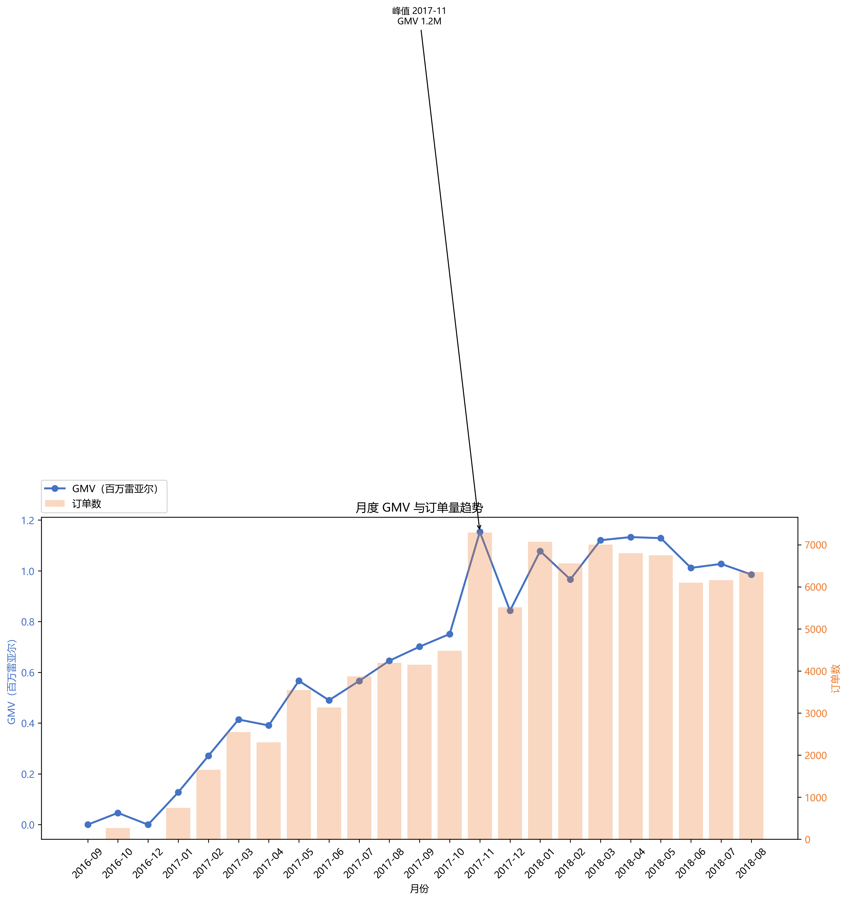
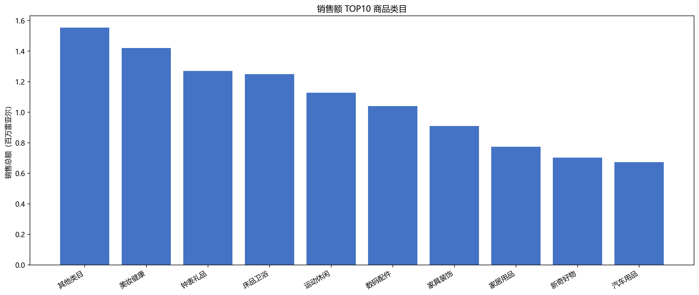
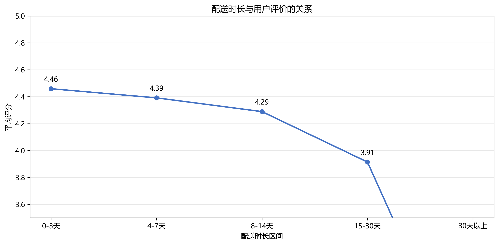
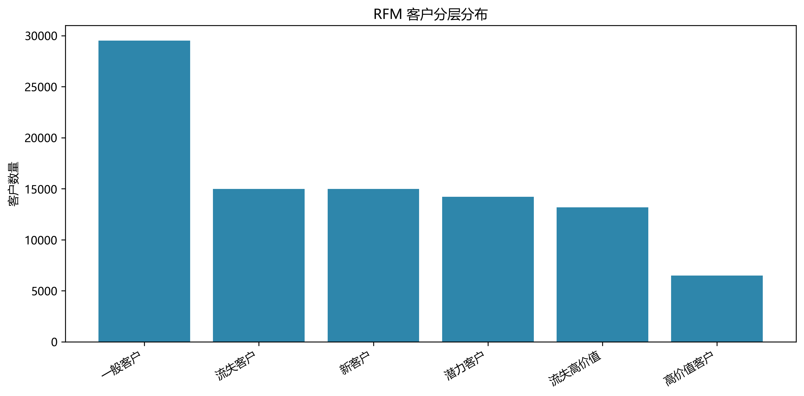

# Olist 巴西电商数据分析

基于 Kaggle Olist 巴西电商公开数据集（约 10 万订单），完整走通 **MySQL 取数 → Python 清洗建模 → Power BI 可视化** 的分析链路，输出销售、用户、商品、履约、口碑五个维度的结论与业务建议。

## 项目概览

| 项目 | 说明 |
|---|---|
| 数据规模 | 9 张原始表，99,441 条订单，2016-09 ~ 2018-10 |
| 分析窗口 | 2016-09 ~ 2018-08，96,470 单已交付订单 |
| 核心指标 | 订单 96,470 单，商品销售额 1,322 万雷亚尔，含运费 GMV 1,542 万，客单价 159.8 雷亚尔 |
| 交付物 | SQL 查询脚本、Python 分析脚本与图表、4 份清洗后数据、Power BI 交互式看板 |

## 技术栈

- **MySQL 8.0**：多表 JOIN、CTE、窗口函数（`ROW_NUMBER` / `LAG` / `NTILE` / 累计求和），15 条分析查询
- **Python（Pandas / NumPy / Matplotlib）**：异常值清洗、缺失值处理、RFM 分层、衍生指标、7 张图表
- **Power BI**：DAX 度量值、日期表、切片器联动，销售 / 用户 / 商品 / 履约四页看板

## 子项目：AI 智能体

在本数据分析项目基础上，额外开发了两个 LLM 应用子项目，代码均在本仓库内：

### 1. 电商数据智能分析 Agent（[olist_agent/](olist_agent/)）

基于 LangChain `create_pandas_dataframe_agent` 搭建 ReAct 架构的自然语言问数 Agent。用户提问后自动生成并执行 Pandas 代码，支持多轮对话与图表生成。

- 技术栈：LangChain · qwen-plus · Streamlit · Pandas
- 评测：自建 20 题评测集，三轮迭代准确率 65%→95%→100%（自构建评测集，不代表泛化）
- 平均响应 3.9 秒
- 详见 [olist_agent/README.md](olist_agent/README.md)

### 2. RAG 企业知识库问答 Agent（[rag_agent/](rag_agent/)）

基于 LangChain + FAISS 搭建的文档问答系统。上传文档后自动切分向量化，用户提问时检索相关片段由 LLM 生成带来源引用的回答，超纲问题主动拒答。

- 技术栈：LangChain · text-embedding-v3 · FAISS · qwen-plus · Streamlit
- 评测：自建 18 题评测集（含超纲拒答题），检索命中 18/18，答案准确率 18/18
- 平均响应 1.3 秒
- 详见 [rag_agent/README.md](rag_agent/README.md)

## 数据说明

原始数据放在 `data/`，Python 分析使用其中 6 张表，SQL 第 12、13 条额外使用支付表与卖家表：

| 表 | 内容 | 行数 |
|---|---|---|
| olist_orders | 订单主表（状态、下单/交付/预计交付时间） | 99,441 |
| olist_order_items | 订单商品明细（价格、运费） | 112,650 |
| olist_products | 商品与品类 | 32,951 |
| olist_customers | 客户与所在州 | 99,441 |
| olist_reviews | 订单评价（1~5 分） | 99,224 |
| product_category_name_translation | 品类葡语→英语映射 | 71 |
| olist_order_payments | 支付记录（方式、分期） | 103,886 |
| olist_sellers | 卖家与所在州 | 3,095 |

数据来源：https://www.kaggle.com/datasets/olistbr/brazilian-ecommerce

## 项目结构

```
olist-brazil-ecommerce-analysis/
├── data/                      # 原始 CSV（不入库版本控制）
├── sql/
│   └── analysis.sql           # 15 条分析查询（MySQL 8）
├── scripts/
│   ├── analysis.py            # 清洗 + RFM + 类目分析 + 图表
│   ├── powerbi_dax.txt        # DAX 度量值清单
│   ├── POWERBI_STEP_BY_STEP.md# 看板搭建步骤
│   ├── POWERBI_GUIDE.md
│   ├── 面试问答稿.md
│   └── 简历项目经历.txt
├── docs/
│   └── 指标口径表.md            # 指标定义与分子分母（统一 Python/SQL/Agent）
├── olist_agent/               # LangChain 自然语言问数 Agent（独立项目）
├── output/
│   ├── csv/                   # clean_wide / orders_base / rfm_result / category_*（给 Power BI 与 Agent）
│   └── charts/                # 7 张分析图
├── powerbi/                   # 看板文件
└── README.md
```

## 分析流程

1. **SQL 取数**：CSV 导入 MySQL，用 JOIN + 聚合提取月度趋势、品类、州、履约、评价、RFM 基础指标。
2. **Python 清洗**：统一日期类型、去重、剔除时间非法与金额异常记录，构建订单级宽表 `clean_wide.csv`（5 个衍生字段：订单总金额、实际配送天数、是否延迟等）。
3. **指标建模**：RFM 五等分打分并按 R/F/M 组合划分 6 类客户；类目销售与差评率统计。
4. **Power BI 看板**：导入清洗后数据，写 DAX 度量值，搭建可联动筛选的看板。
5. **结论输出**：结合图表给出可执行的业务建议。

## 核心发现

**1. 配送时效是差评的首要驱动因素**

| 实际配送天数 | 订单数 | 平均评分 | 差评率 |
|---|---|---|---|
| 0-3 天 | 8,602 | 4.46 | 7.1% |
| 4-7 天 | 25,094 | 4.39 | 7.7% |
| 8-14 天 | 36,397 | 4.29 | 9.2% |
| 15-30 天 | 22,260 | 3.91 | 17.1% |
| 30 天以上 | 4,117 | 2.17 | **65.3%** |

30 天以上订单的差评率是 0-3 天的 9 倍，配送时长超过 15 天后评分开始明显下滑。整体延迟率 8.1%，但只要延迟，口碑损失极大。

**2. 区域履约能力差异显著**

SP（圣保罗）州 40,494 单，占全部订单 42.0%，平均配送 8.3 天、延迟率 5.9%；RJ（里约）12,350 单，平均配送 14.8 天、延迟率 13.5%，是履约短板区域。

**3. 头部品类集中在美妆健康、钟表礼品、床品卫浴**

| 品类 | 订单数 | 销售总额（含运费） | 延迟率 |
|---|---|---|---|
| 其他类目（未映射） | 8,503 | 155.3 万 | 7.8% |
| 美妆健康 | 8,836 | 142.0 万 | 9.0% |
| 钟表礼品 | 5,624 | 126.9 万 | 8.5% |
| 床品卫浴 | 9,417 | 124.9 万 | 8.7% |
| 运动休闲 | 7,720 | 112.7 万 | 7.8% |

注：「其他类目」为翻译表未覆盖的类目（约占订单 8.8%），单列以便看清真实品类排名。

**4. 办公家具是口碑最差的品类**

办公家具差评率 **22.0%**（1,244 单，平均评分 3.64），约为大盘 12.8% 的 1.7 倍；音频设备 21.7%。男士服饰 22.9% 但仅 105 单评价，样本偏小、波动大，不作为主结论。这类大件商品体积大、安装复杂，差评集中在物流破损与安装体验。

**5. 用户结构以一次性购买为主，高价值客户占比低**

93,350 名用户中，仅下单 1 次的占 **97%**；RFM 分层结果：

| 分层 | 人数 | 占比 |
|---|---|---|
| 一般客户 | 29,517 | 31.6% |
| 流失客户 | 14,986 | 16.0% |
| 新客户 | 14,980 | 16.0% |
| 潜力客户 | 14,208 | 15.2% |
| 流失高价值 | 13,161 | 14.1% |
| 高价值客户 | 6,498 | 7.0% |

**6. 销售存在明显季节性**

2017-11（黑五）GMV 115.3 万、7,288 单，为全周期峰值；2018-03 ~ 2018-05 维持高位。

## 业务建议

1. **按区域承诺时效**：对 RJ 等延迟高发州单独设置更保守的预计送达时间，并优先在该区域增设中转仓，减少“未超时但等待过久”导致的差评。
2. **长尾延迟专项治理**：对配送超过 15 天的订单建立预警与主动客服触达，这部分订单差评率接近 20%，是口碑的最大风险池。
3. **大件品类体验改造**：办公家具、床品卫浴强化包装标准、提供安装说明与预约配送，目标把差评率压到 15% 以内。
4. **复购运营**：97% 用户只购买一次，可在首次订单签收后 7~15 天发放品类券，重点唤回“新客户”和“流失高价值”两类人群。
5. **旺季资源前置**：以 11 月峰值为基准提前备货与锁定运力，避免旺季延迟率进一步恶化。

## SQL 模块

`sql/analysis.sql` 共 15 条查询，覆盖销售、履约、评价、用户、支付、卖家六个主题：

| 编号 | 查询 | 输出 |
|---|---|---|
| Q1 | 月度销售趋势 | 月份、订单数、商品销售额、运费、订单总额、客单价 |
| Q2 | 品类销售 + 延迟率 | 71 个品类 |
| Q3 | 州维度订单与履约 | 27 个州 |
| Q4 | 配送时长 × 评价 | 5 个时长分组的评分与差评率 |
| Q5 | 品类差评率 | 63 个有评价品类（订单≥10） |
| Q6 | RFM 原始指标 | 93,350 个用户的 R/F/M 与分层 |
| Q7 | 月度环比 + 近 3 月均值 | `LAG` 环比、移动窗口 |
| Q8 | 新客 / 老客拆分 | 按用户首单月份 |
| Q9 | 复购率 + 复购间隔 | 复购用户占比、首单到二单天数 |
| Q10 | 品类内 TOP3 商品 | `ROW_NUMBER() PARTITION BY` |
| Q11 | 州维度帕累托 | GMV 排名与累计占比 |
| Q12 | 支付方式分布 | 各方式订单数、金额、分期占比 |
| Q13 | 卖家 TOP10 履约质量 | GMV、延迟率、评分（≥30 单） |
| Q14 | 品类连续两月下滑预警 | 分组内双 `LAG` |
| Q15 | 首单月留存 | 30 / 60 天复购率（cohort） |

口径统一以 [docs/指标口径表.md](docs/指标口径表.md) 为准：订单粒度、GMV 含运费、比率分母为「有评价订单 / 已送达订单」。

## Python 模块

`python scripts/analysis.py` 一键完成清洗、分析与图表输出：

- 清洗规则：订单去重、状态过滤、日期合法性校验、`price > 0` 与 `freight_value >= 0`
- RFM：R 用最后下单距全量最新下单日的天数，F 用去重订单数，M 用含运费总金额；五分位打分后映射为 6 类客户
- 输出：`output/csv/` 5 份数据文件、`output/charts/` 7 张 PNG

## Power BI 看板

搭建步骤见 `scripts/POWERBI_STEP_BY_STEP.md`，DAX 度量值见 `scripts/powerbi_dax.txt`。

- 数据源：`orders_base.csv`（订单粒度）、`rfm_result.csv`、`category_sales_stats.csv`、`category_review_stats.csv`
- 页面：销售总览 / 用户 RFM / 商品品类 / 履约与口碑
- 关键度量值：订单总数、商品销售额、客单价、延迟率、平均评分、差评率、客户数
- 交互：年份、州、品类切片器联动全部图表

<!-- 看板截图：将 Power BI 截图保存为 img/dashboard_sales.png 与 img/dashboard_user.png 后，取消下面两行注释 -->
<!--  -->
<!--  -->

## 分析图表






## 数据质量处理记录

- **翻译表重复导入**：库中品类翻译表出现 142 行（71 类目 × 2），已去重并通过 `SELECT DISTINCT` 在查询层兜底，避免金额翻倍。
- **首尾月份样本不足**：2016-09、2016-12 各仅 1 单，2016-11 无已交付订单，分析统一从 2017-01 起算。
- **时间字段异常**：存在交付时间早于下单时间、交付时间为空的记录，均按无效订单剔除。
- **评价一对多**：部分订单有多条评价，统一取首条，保证订单级唯一。

## 局限与后续优化

1. 缺少用户画像（年龄、性别等），无法做更细的用户标签与人群圈选。
2. 仅做描述性分析，未构建销量预测或流失预测模型。
3. 品类中文映射覆盖 63/73 个类目，其余归入「其他类目」（约占订单 8.8%）。
4. 可补充支付方式、卖家维度分析，以及营销活动 A/B 测试的效果评估框架。
